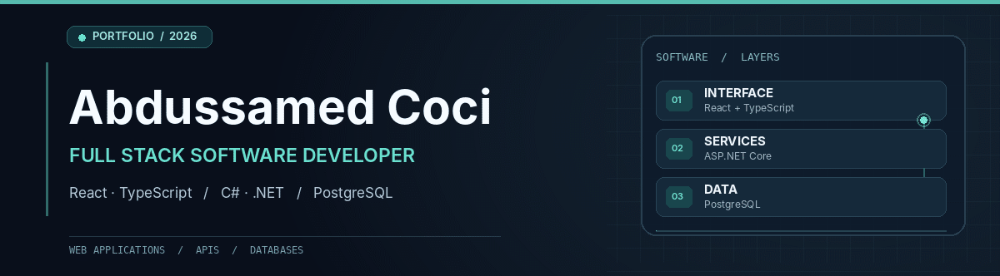
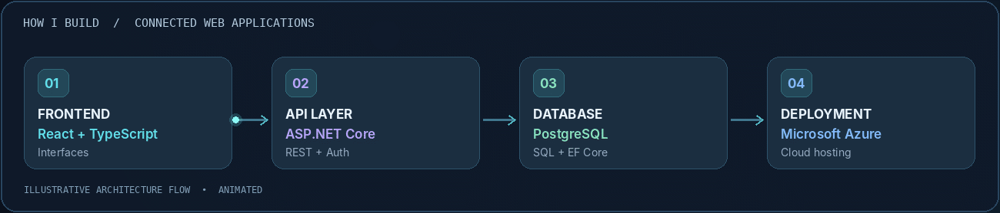
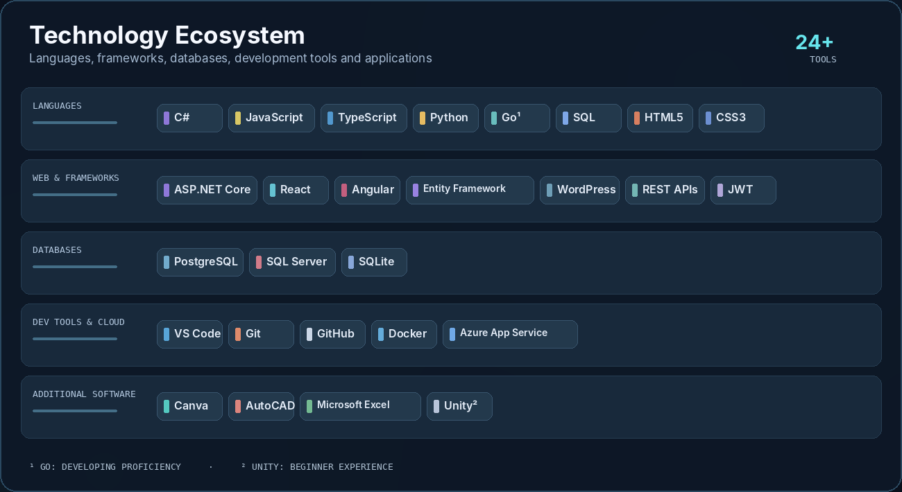

<!-- Professional GitHub Profile • Abdussamed Coci • Full Stack Software Developer -->

  
   
  
   
  <a href="#featured-project">Featured work</a> &nbsp; • &nbsp;
  <a href="#projects">Projects</a> &nbsp; • &nbsp;
  <a href="#technology-stack">Tech stack</a> &nbsp; • &nbsp;
  <a href="#github-activity">GitHub activity</a> &nbsp; • &nbsp;
  <a href="#about-me">About</a>

---

<table>
<tr>
<td width="63%" valign="top">

### Hello, I'm Abdussamed.

A **Full Stack Software Developer** based in **Istanbul, Türkiye**, building web applications across the interface, business-logic, and database layers. I work primarily with **React, TypeScript, C#/.NET and PostgreSQL**, and develop Python utilities while expanding my Go skills.

I enjoy taking a product idea from its first screen to its data model and API.

[**Explore my repositories ↗**](https://github.com/acoci0?tab=repositories)

</td>
<td width="37%" valign="top">

### What I'm working on

**Building:** [NotMarket](https://github.com/acoci0/NoteMark) — student notes marketplace, currently in development.

**Focus:** End-to-end web applications, authentication, REST APIs, relational databases.

**Learning:** Go and deeper backend practices.

</td>
</tr>
</table>

## Featured Project

<table>
<tr>
<td width="66%" valign="top">

### [NotMarket — Student Notes Marketplace](https://github.com/acoci0/NoteMark)

**In development** · Full stack application

University-focused notes marketplace. The current repository contains an **ASP.NET Core 10 API** and an **administration panel with React 19 + TypeScript**, including student verification, user management and note moderation.

**Development areas:** JWT authentication, role-based authorization, REST endpoints, Entity Framework Core, PostgreSQL and frontend administration workflows.

[**View repository and source code →**](https://github.com/acoci0/NoteMark)

</td>
<td width="34%" align="center" valign="middle">

**C# / .NET** · **React** · **PostgreSQL**

</td>
</tr>
</table>

### From idea to application

  
   
  Illustrative full stack architecture — conceptual animation, not live system telemetry or test results.

## Projects

<table>
<tr>
<td width="50%" valign="top">

### [Yemekli Yılan ↗](https://github.com/acoci0/menu-snakeminigame)

Mobile-friendly browser snake game with user accounts and score tracking, developed as a restaurant-menu experience.

`C#` `ASP.NET Core` `JavaScript` `SQLite`

</td>
<td width="50%" valign="top">

### [Python Task Manager ↗](https://github.com/acoci0/TNC-Python)

Console-based task management with priorities, deadlines, status tracking and persistent JSON storage.

`Python` `JSON` `CLI`

</td>
</tr>
<tr>
<td width="50%" valign="top">

### [Text-to-PDF Converter ↗](https://github.com/acoci0/PDF_converter)

Small Python utility that generates Unicode-compatible PDF documents using FPDF.

`Python` `FPDF` `PDF`

</td>
<td width="50%" valign="top">

### Currently Exploring

Expanding my skills with **Go**, improving API design, and developing complete workflows from frontend components to data persistence.

`Go (learning)` `REST APIs` `SQL`

</td>
</tr>
</table>

## Technology Stack

  

**Languages**

  
  

**Web Development & Frameworks**

ASP.NET Core · Entity Framework Core · React · Angular · WordPress · REST APIs · JWT authentication

**Databases**

  
  

PostgreSQL · Microsoft SQL Server · SQLite

**Developer Tools & Cloud**

VS Code · Git · GitHub · Docker · Microsoft Azure / Azure App Service

**Other Applications**

  
  
  
  

Experience varies by tool. Currently building proficiency in Go; basic experience with Unity.

## GitHub Activity

  
  

<!-- RELIABLE ACTIVITY SECTION: compact links + live repository badges -->
<table>
  <tr>
    <td width="55%" valign="top">
      <b>LIVE PROJECT ACTIVITY</b>
      <h3><a href="https://github.com/acoci0/NoteMark">NotMarket · Recent Development</a></h3>
      
Track actual source-code updates in the public NotMarket repository.

      

        
        
      

      
<a href="https://github.com/acoci0/NoteMark/commits/main"><b>View recent commits ↗</b></a>

    </td>
    <td width="45%" valign="top">
      <b>GITHUB CONTRIBUTIONS</b>
      <h3>My Contribution History</h3>
      
Explore my contribution calendar and activity directly on GitHub, rather than loading an unreliable external graph.

      
<a href="https://github.com/acoci0?tab=overview"><b>Explore contribution history ↗</b></a>

    </td>
  </tr>
</table>

Project badges reflect public GitHub repository activity and may be cached. Language breakdown is based on repository contents, not overall proficiency.

## About Me

I earned my degree in **Mathematics at Marmara University** and completed a **software development training program at BilgeAdam Academy**. My mathematics background supports my approach to debugging, data modeling and clear problem-solving.

I enjoy developing software across the stack — from usable web interfaces to maintainable APIs and database-backed business features. I'm interested in real-world products and collaborative development.

### Development principles

`Understand the problem` &nbsp; → &nbsp; `Build the smallest useful solution` &nbsp; → &nbsp; `Test & improve`

---

  <b>Let's build useful software.</b>
    
  
    
  Abdussamed Coci · Full Stack Software Developer · Istanbul, Türkiye

