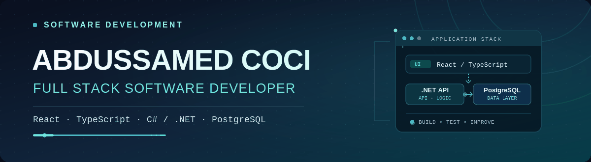
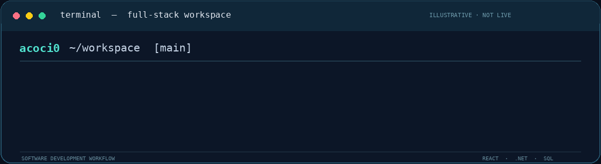

<!-- GitHub profile README for github.com/acoci0 -->

<div align="center">
  
  <br/>
  
  <br/>
  <a href="https://github.com/acoci0?tab=repositories"></a>
  
</div>

<br/>

<div align="center">
  <strong>Backend Development &nbsp;·&nbsp; API Design &nbsp;·&nbsp; Database-Driven Applications</strong>
  <br/>
  <sub>Building practical software with a focus on maintainability, reliability, and clear architecture.</sub>
</div>

---

## Featured Project

<table>
  <tr>
    <td width="69%" valign="top">
      <sub><b>FEATURED WORK · IN DEVELOPMENT</b></sub>
      <h3><a href="https://github.com/acoci0/NoteMark">NotMarket — Student Notes Marketplace</a></h3>
      <p>
        A university-oriented notes marketplace project with an ASP.NET Core API and
        an administrative interface for student verification, user management,
        and content moderation.
      </p>
      <p>
        <b>Engineering highlights</b><br/>
        REST API development · JWT-based authentication and authorization ·
        PostgreSQL / Entity Framework Core · React + TypeScript administration panel
      </p>
      <a href="https://github.com/acoci0/NoteMark"><b>Explore repository ↗</b></a>
    </td>
    <td width="31%" align="center" valign="middle">
      
      <br/><br/>
      <sub>ASP.NET Core 10 · PostgreSQL<br/>React 19 · TypeScript</sub>
    </td>
  </tr>
</table>

## Engineering Workflow

<div align="center">
  
  <br/>
  <sub>Illustrative terminal animation · Not a live build or test result.</sub>
</div>

<br/>

## Selected Projects

<table>
  <tr>
    <td width="50%" valign="top">
      <h3><a href="https://github.com/acoci0/menu-snakeminigame">Yemekli Yılan</a></h3>
      <p>Mobile-friendly browser game designed for the restaurant ordering experience, with account management and a score leaderboard.</p>
      <sub><code>C#</code> <code>ASP.NET Core</code> <code>JavaScript</code> <code>SQLite</code></sub>
      <br/><br/>
      <a href="https://github.com/acoci0/menu-snakeminigame">View code →</a>
    </td>
    <td width="50%" valign="top">
      <h3><a href="https://github.com/acoci0/TNC-Python">Python Task Manager</a></h3>
      <p>Console-based task management tool supporting task metadata, priorities, status tracking, and JSON persistence.</p>
      <sub><code>Python</code> <code>JSON</code> <code>CLI</code></sub>
      <br/><br/>
      <a href="https://github.com/acoci0/TNC-Python">View code →</a>
    </td>
  </tr>
  <tr>
    <td width="50%" valign="top">
      <h3><a href="https://github.com/acoci0/PDF_converter">Text-to-PDF Converter</a></h3>
      <p>Lightweight Python utility that creates PDF documents from text using FPDF and a Unicode-compatible font.</p>
      <sub><code>Python</code> <code>FPDF</code> <code>Unicode</code></sub>
      <br/><br/>
      <a href="https://github.com/acoci0/PDF_converter">View code →</a>
    </td>
    <td width="50%" valign="top">
      <h3>Currently Exploring</h3>
      <p>Extending my backend engineering toolkit with Go, improving API design practices, and refining database-backed application architecture.</p>
      <sub><code>Go</code> <code>REST APIs</code> <code>SQL</code> <code>Software Architecture</code></sub>
    </td>
  </tr>
</table>

## About Me

```csharp
var developer = new
{
    Name = "Abdussamed Coci",
    Role = "Backend Software Developer",
    Location = "Istanbul, Türkiye",
    Focus = new[] { "ASP.NET Core", "REST APIs", "SQL", "Go" },
    Mindset = "Learn continuously. Build deliberately. Improve consistently."
};
```

I have an academic background in **Mathematics at Marmara University** and completed a
**.NET software development program at BilgeAdam Academy**. My work combines analytical
problem-solving with hands-on experience building backend services and web applications.

I'm particularly interested in **API development, authentication, relational data modeling,
and turning product requirements into maintainable software**.

## Tech Stack

**Backend & Languages**

<p>
  
</p>

**Web & Data**

<p>
  
</p>

**Tools & Cloud**

<p>
  
</p>

## GitHub Activity

<div align="center">
  
  
</div>

<sub>Language statistics describe public repository contents, not overall proficiency.</sub>

---

<div align="center">
  <strong>Interested in backend engineering, useful products, and collaborative development.</strong>
  <br/><br/>
  <a href="https://github.com/acoci0"></a>
  <br/><br/>
  <sub>Abdussamed Coci · Istanbul, Türkiye</sub>
</div>
