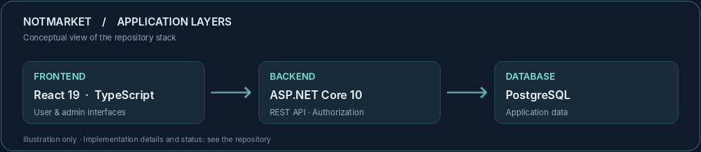

<!-- GitHub profile README | Abdussamed Coci | Full Stack Software Developer -->

  

 

<table>
  <tr>
    <td width="68%" valign="top">
      <h3>Building software from interface to database.</h3>
      
I'm <b>Abdussamed Coci</b>, a full stack software developer based in Istanbul. I build web applications with <b>React, TypeScript, C#/.NET</b> and <b>PostgreSQL</b>, with a focus on practical features and maintainable code.

      
<a href="#selected-work"><b>View selected work ↗</b></a> &nbsp; · &nbsp; <a href="https://github.com/acoci0?tab=repositories">All repositories ↗</a>

    </td>
    <td width="32%" valign="top">
      <h4>Current focus</h4>
      
<b>Building</b> <a href="https://github.com/acoci0/NoteMark">NotMarket</a> · Student notes platform

      
<b>Exploring</b> Go · API design · SQL

    </td>
  </tr>
</table>

<a href="#selected-work">SELECTED WORK</a> &nbsp; / &nbsp; <a href="#technology-stack">TECH STACK</a> &nbsp; / &nbsp; <a href="#background">BACKGROUND</a> &nbsp; / &nbsp; <a href="#connect">CONNECT</a>

---

## Selected Work

### NotMarket · Featured project · In development

A university-focused notes marketplace. The repository currently includes an **ASP.NET Core API** and a **React + TypeScript administration panel** for user management, student verification, and note moderation.

**What I've been working on:** authentication and role-based access, database models, and administration workflows. The product is still being developed.

[**Explore NotMarket source →**](https://github.com/acoci0/NoteMark)

### More Projects

<table>
  <tr>
    <td width="50%" valign="top">
      <h3><a href="https://github.com/acoci0/menu-snakeminigame">Yemekli Yılan ↗</a></h3>
      
Mobile-first browser snake game with user accounts and score tracking.

      <code>ASP.NET Core</code> &nbsp; <code>JavaScript</code> &nbsp; <code>SQLite</code>
    </td>
    <td width="50%" valign="top">
      <h3><a href="https://github.com/acoci0/TNC-Python">Python Task Manager ↗</a></h3>
      
Command-line task management tool with priorities, deadlines, and JSON storage.

      <code>Python</code> &nbsp; <code>CLI</code> &nbsp; <code>JSON</code>
    </td>
  </tr>
  <tr>
    <td colspan="2" valign="top">
      <h3><a href="https://github.com/acoci0/PDF_converter">Text-to-PDF Converter ↗</a></h3>
      
A lightweight Python utility that generates PDF files using FPDF and Unicode fonts.

      <code>Python</code> &nbsp; <code>FPDF</code>
    </td>
  </tr>
</table>

## Technology Stack

<table>
  <tr>
    <td width="33%" valign="top">
      <h4>01 / Frontend</h4>
      React TypeScript / JavaScript HTML / CSS
    </td>
    <td width="34%" valign="top">
      <h4>02 / Backend</h4>
      C# / ASP.NET Core REST APIs Python · Go (learning)
    </td>
    <td width="33%" valign="top">
      <h4>03 / Data &amp; Tools</h4>
      PostgreSQL / SQL Entity Framework Core Git · Docker · Azure
    </td>
  </tr>
</table>

## Background

I studied **Mathematics at Marmara University** and completed a software development program at **BilgeAdam Academy**. I enjoy translating real-world requirements into clear interfaces, useful APIs, and reliable data flows.

My current priorities are strengthening my full stack development skills, improving API design, and contributing to software projects where code quality and teamwork matter.

## Connect

Interested in working together or discussing a project? You can explore my [repositories](https://github.com/acoci0?tab=repositories) and reach me through my [GitHub profile](https://github.com/acoci0).

Abdussamed Coci · Full Stack Software Developer · Istanbul, Türkiye
